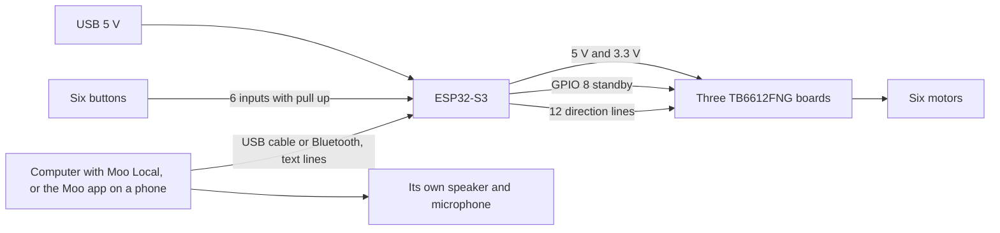

%% Written on 22 November 2026, the day of the work, from the session on the Mac. Board facts are from Espressif's user guide and PCB drawing of the ESP32-S3-DevKitC-1 and from the Toshiba TB6612FNG datasheet. The row order of the driver boards is the SparkFun layout and was not checked against the maker's boards. Fits were checked by intersecting the new parts with meshes rendered from the newest sources of the bottom shell and the motor casing. Nothing was printed or run on a board that day. Files are in finalMooMoo/esp32Variant. %%

# Goals
- Make a second, cheaper Moo with an ESP32 in place of the Raspberry Pi, and keep everything else the same
- Let the computer or the phone do the story, the listening and the voice, connected by a USB cable or by Bluetooth
- Draw the connection schema of the ESP32, the three motor drivers, the six motors and the six buttons
- Design a printed part that holds the cables between the ESP32 and the drivers, with one common ground
- Test two ways of joining the wires before printing the whole part: copper tape in a small test device, and a tray that holds the wire ends

# Description
In the reflection of step 36 the maker described a cheaper device: an ESP32, six motors, TB6612 drivers, six buttons and the prints, with the phone doing the AI, playing the stories and listening through its own microphone, for about 20 dollars less. On 22 November 2026 he asked for it as an alternative version, with connection schemas, and for a printed element that gathers the cables from the ESP32 to the motor controllers. He named two methods to test, a small device with copper tape, and a tray that the wires with Dupont ends go into, which then plugs onto the ESP32 and the controllers, all of them on one ground.

The ESP32 is not new to Moo. The first workbook drove the dots from an ESP32-S3 through TB6612FNG boards (step 16) and joined it to the Pi over UART (step 15). The photos of that setup show breadboards and loose jumper wires on a sheet of cardboard (step 9). Step 30 removed the ESP32 so that one computer did everything. This step brings it back as the only computer in the device, and leaves the AI to the machines that already run it: Moo Local on a computer (step 34) and the Moo app on a phone (step 36).

Everything else stays the same. The three shells, the six modules and their motors and buttons are the files of steps 21 to 29. The new part sits on the floor of the unchanged bottom shell, held by the centre block and the zip tie tunnels that step 28 found and could not explain.

# File Timeline
| Time | What happened |
|---|---|
| About 12:10 | The pin use of the first workbook, the Pi driver `braille_gpio.py` and the bottom shell of step 28 are read again |
| About 12:20 | The pin order of the ESP32-S3-DevKitC-1 is read from Espressif's user guide, its size and row spacing from Espressif's PCB drawing, and the internal pull down resistors of the TB6612FNG from its datasheet |
| 12:27 | The bottom shell and the motor casing are rendered from their newest sources. The modules leave a strip about 47 mm wide free along the centre line of the floor, from 21 mm on one side to 26 mm on the other |
| 12:33 | `tools/pinmap.py`, one pin map from which the firmware pins, the tray and the wire list are generated |
| 12:35 | `cad/mooEsp32Tray.scad`, the tray, its lid and two test prints |
| 12:36 | The tray is checked against the shell, the six modules, the boards and the USB plug. Two feet sit 1 mm in the chamfer of the floor and are moved |
| 12:37 | The wiring schema is drawn from the pin map |
| 12:39 | The firmware compiles for the ESP32-S3 |
| 12:41 | The test prints are rendered. The feet of the mini device were shorter than its seats and are lengthened |
| About 12:45 | The maker asks for the computer side to be built next |
| About 12:50 | `braille_esp32.py`, the Pi's braille driver speaking to the ESP32 over USB, and a pretend ESP32 in Python. Fourteen checks pass |
| 12:55 | The Moo's own setup app runs on the Mac against the pretend ESP32. Letter practice and calibration are driven through its website endpoints |
| About 13:00 | A whole story runs on the Mac with a stand-in AI server: greeting, the theme, the story, the word cat spelled on the dots, goodbye |

# How it works
## What moves where
| Job | Pi Moo, steps 30 to 38 | ESP32 Moo |
|---|---|---|
| Raising and lowering the dots, reading the buttons | Raspberry Pi Zero 2 W | ESP32-S3-DevKitC-1 |
| Story, listening, voice | The Pi calls Moo Local, a lent phone or the cloud | The computer or the phone itself |
| Speaker and microphone | USB sound card in the device, two 50 mm speakers | The computer's or the phone's own |
| Link | Home wifi, the Moo's own wifi, Bluetooth for setup | USB cable to a computer, or Bluetooth Low Energy |
| Power | Power bank in the pocket of the middle shell | The USB cable from the computer, or the same power bank |
| Setup | Website on the Pi, wifi password, calibration | No wifi to set. Calibration is kept on the ESP32 |

A USB cable to a computer is the simplest link of all. It carries the power and the commands, and it needs no network, no password and no pairing. Bluetooth is there for the phone, which matches what the maker asked for in step 36.

## The connection schema
![[MooMooRedesign_39_wiring.png]]
Every wire of the device. Each colour is one motor. A dot on a bus is one wire laid in the copper tape groove of that bus

| ESP32 pin | GPIO | Goes to | Line |
|---|---|---|---|
| J1-4, J1-5 | 4, 5 | D1 AIN1, AIN2 | Motor 0 |
| J1-6, J1-7 | 6, 7 | D1 BIN1, BIN2 | Motor 1 |
| J1-8, J1-9 | 15, 16 | D2 AIN1, AIN2 | Motor 2 |
| J1-10, J1-11 | 17, 18 | D2 BIN1, BIN2 | Motor 3 |
| J1-15, J1-16 | 9, 10 | D3 AIN1, AIN2 | Motor 4 |
| J1-17, J1-18 | 11, 12 | D3 BIN1, BIN2 | Motor 5 |
| J1-12 | 8 | STBY bus, to STBY of all three boards | Standby |
| J3-4 to J3-9 | 1, 2, 42, 41, 40, 39 | Port P0 to P5, BTN | Buttons 0 to 5 |
| J1-21 | 5V | 5 V bus, to VM of all three boards | Motor supply |
| J1-1 | 3V3 | 3.3 V bus, to VCC, PWMA and PWMB of all three boards | Logic supply, full speed |
| J1-22, J3-1 | G | GND bus | Ground |

| Bus | Wires into its groove |
|---|---|
| GND | 11. The ESP32 twice, one GND of each driver, and the button return of each of the six ports |
| 3.3 V | 10. The ESP32, and VCC, PWMA and PWMB of each driver |
| 5 V | 4. The ESP32 and VM of each driver |
| STBY | 4. GPIO 8 and STBY of each driver |

The pins were chosen for three reasons.
- All twelve direction lines and the standby line are on one header, J1, the side that faces the drivers. All six buttons are side by side on J3, the side that faces the other row of modules
- The strapping pins 0, 3, 45 and 46, the USB pins 19 and 20, the serial pins 43 and 44, the pins 35 to 37 that boards with octal PSRAM use inside, and the LED pins 38 and 48 are left free
- None of the pins used has a pull up while the ESP32 starts. The TB6612FNG has a pull down of 200 kΩ inside on every input, STBY included, so the drivers stay switched off until the firmware has set every direction pin low. That is the same rule as GPIO 26 on the Pi

As on the Pi, PWM is tied to 3.3 V and the motors always run at full speed. The motor supply comes from the 5 V pin of the ESP32, which is the USB supply, as it came from the 5 V pin of the Pi.

## The printed tray
![[MooMooRedesign_39_tray_in_bottom_shell.png]]
The tray in blue on the floor of the bottom shell, between the two rows of modules. The ESP32 lies on the left with its USB end toward the cable slot of the short wall, the three drivers in red on the right, the copper coloured lid over the buses in the middle

The tray answers both methods the maker named. Every wire end is a female Dupont housing standing in a printed seat. The ESP32 and the three drivers press into their seats from above with their pins down, so the tray plugs onto the boards as he described. Every power and ground wire ends in a groove lined with copper tape, so all boards share one ground without a wire from each board to each other board.

| Part | What it does |
|---|---|
| Seats | A row of slots for each header row of a board, as many as the row has pins. Where a pin carries a wire the slot holds a housing, 2.60 mm wide, on two lips 1.2 mm high. Where it carries nothing the pin goes into a blind hole of 1.3 mm |
| Wire slit | Under the lips a slit of 1.6 mm runs along the whole row and out of both ends. A wire whose other end already has its housing can be slid in from the side |
| Ports | Six rows of four seats on the edges of the tray, one for each module: motor, motor, button, ground. The module's cable plugs in from above. Which module is which dot is set by the calibration of step 31, so any module can go into any port |
| Copper tape buses | Four grooves of 5.4 mm for copper tape of 5 mm, 30 mm long: 5 V, 3.3 V, STBY and GND. The wires come up through slots at both ends and lie on the tape with 6 mm of bare copper |
| Lid | Four ridges of 1 mm press the bare ends onto the tape. The bus names are cut into it |
| Holding it down | The deck rests on four posts on the centre block of the bottom shell and on four feet on the floor. Two zip ties through the tunnels of the block go up past the deck and over the lid. They hold the tray down and press the lid at the same time |

![[MooMooRedesign_39_tray_top.png]]
The tray from above. The seats of the ESP32 rows on the left, the four grooves in the middle, the seats of the three drivers on the right, a port at each edge near each module, and the zip tie slots beside the grooves

| Check against the newest files | Result |
|---|---|
| Tray and shell | Touch only where they should: the feet on the floor and the posts on the centre block. Two feet at first sat 1 mm into the chamfer where the floor meets the short wall and were moved 1.5 mm inward |
| Tray and the six modules, with the clamp rings | No overlap |
| ESP32, drivers, module plugs and the USB plug, drawn as boxes, against the shell, the modules and the tray | No overlap. The closest pair is a module plug and the clamp ring of its module, 2.7 mm apart |
| Height | The boards rest at 31.5 mm above the table, under the rim of the bottom shell at 40 mm |
| USB | The USB end of the ESP32 is 21 mm from the inside of the short wall, in line with the existing cable slot |

The tray is 169 by 40 mm and 26 mm tall and uses 30.1 cm³ of plastic. It prints deck down, so the seats grow upward and the lips are the last layers of each slot.

## The two test prints
![[MooMooRedesign_39_test_prints.png]]
Left, the fit coupon. Right, the mini device with its copper tape lid

| Print | Plastic | What it tests |
|---|---|---|
| Fit coupon | 5.1 cm³ | Five seats for four housings each, 2.50, 2.55, 2.60, 2.65 and 2.70 mm wide, and pin holes of 1.0 to 1.4 mm. The width that holds four housings without forcing them goes into `HOUSING_W` before the tray is printed |
| Mini device | 13.5 cm³, lid 2.2 cm³ | One driver seat, one module port and four short copper tape grooves with a lid held by two M3 screws, the screw size of the Pi plate. It runs one module from the ESP32 with loose jumpers |

The tests to run on the mini device.
| Test | How | Good result |
|---|---|---|
| Tape on PETG | Stick a 5 mm copper tape in each groove and solder one wire end to it | The tape stays down, the groove does not soften |
| Pressed joint | Lay two bare wire ends in one groove without solder and screw the lid down. Measure the resistance between the two Dupont ends | Under 0.5 Ω, the same after pulling on the wires and after an hour |
| Soldered joint | The same with the ends soldered to the tape | Under 0.1 Ω |
| Common ground | ESP32 GND and the driver GND into the GND groove only. Run the motor up and down 20 times with the firmware | The dot moves every time and no button press appears that nobody made |
| Seat | Press the driver board into its seat and pull it out five times | The housings stay in their slots and the board sits flat |

## The Moo software on the computer
The maker asked for the computer side straight after the hardware. It turned out that almost nothing had to be written. The Moo software on the Pi is Python, and its sound already goes through `sounddevice`, which works on a Mac, Windows and Linux. Its story, letters, word games, calibration and website do not touch the GPIO themselves; they call one braille driver. So the whole Moo software now runs on the computer the ESP32 is plugged into, and only the driver is new.

| Piece | What it is |
|---|---|
| `pi/assistant/braille_esp32.py` | The Pi's braille driver with its GPIO calls replaced by lines on the USB serial port. The watchdog, the stagger, the button that lowers its own dot and the presses kept in order are the Pi's own code, inherited |
| `pi/assistant/braille.py` | Picks this driver when the config says `backend: esp32` or `MOO_BRAILLE=esp32` is set. The Pi still gets its GPIO driver |
| `pi/setup_service/services/service_control.py` | A computer has no systemd. The check for the old assistant service now answers stopped there, where it used to fail |
| `esp32Variant/host/moo-on-computer.sh` | Makes a Python environment the first time, keeps the settings in the user's home folder, and starts the Moo's website at `localhost:8000` |
| Firmware 0.2.0 | Adds `RAW <motor> STOP`, which stops a motor at once and drops any start of it still waiting |

The calibration of step 31 works as it does on the Pi. It reorders the pins and swaps a pair for a reversed motor. The driver turns each pair of ESP32 pins back into the motor's wiring number and a direction, and puts the firmware in a plain mode where it lowers no dot by itself, so the computer, which holds the calibration, decides which dot a press lowers. The firmware still keeps its own 1.5 s cap, so a motor stops even if the cable is pulled in the middle of a move.

Three tests were run on the Mac, all without a board, model or microphone.
| Test | Result |
|---|---|
| The driver against a pretend ESP32 written in Python, `tools/test_host.py` | 14 of 14 checks pass: the letter C raises the two right dots and no other, starts are 0.15 s apart, no motor runs past 1.5 s, a press lowers its dot once and is reported, a second press within 2.5 s does not drive the motor again, a reversed motor turns the other way, a moved button counts for its dot, and with no board the driver falls back to dry run |
| The Moo's setup app on the Mac against the pretend ESP32 over a pretend serial port | Letter practice showed D on dots 1, 4 and 5, a press lowered its dot. The calibration wizard's endpoints pulsed a motor and read a button |
| A whole story, `tools/test_story.py`, with a stand-in for Moo Local that answers with fixed text | The real story code ran from greeting to goodbye in 11 seconds. It spelled cat, raising 7 dots, and a pretend child pressed all 7 |

What the computer side needs for a real story is an AI. Moo Local was emptied of its models on 21 November and was not filled again for this test.

## The firmware
`firmware/MooEsp32/MooEsp32.ino` keeps the motor rules of the Pi driver: a motor runs at most 1.5 s from its first command, motors start 0.15 s apart, a button lowers its own dot at most once every 2.5 s, and the drivers wake only after every direction pin is low. The stagger runs from a queue, so the ESP32 never stops to wait.

The computer or the phone sends short text lines, over USB at 115200 baud or over Bluetooth Low Energy. The Bluetooth service is the Nordic UART service under the name Moo- and four characters of the ESP32's address.

| Line | What the Moo does |
|---|---|
| `PING` | Answers `OK MOO-ESP32 0.2.0` |
| `L c` | Raises the dots of the letter c and lowers the others |
| `D 100100` | The same with the six dots given one by one |
| `UP 3`, `DOWN 3`, `STOP 3`, `RESET` | One dot, or every dot down |
| `RAW 4 UP`, `RAW 4 STOP` | One motor by its wiring number. The computer uses these, since it keeps the calibration |
| `MAP 012345 012345 000000` | Which motor and which button belong to dots 1 to 6, and which motors turn the wrong way. Kept in flash |
| Sent by the Moo, `BTN 3` | Dot 3 was pressed |

Its letter table is standard braille with dots numbered 1 to 6, M included as dots 1, 3 and 4. The letter table on the Pi still gives M the dots of F, as found in September (step 29). `tools/moo_serial.py` drives the Moo from a computer over USB: a prompt for the lines above, a test of every dot and letter, or a word spelled letter by letter, each letter waiting until its raised dots have been pressed.

The firmware compiles for the ESP32-S3 with Arduino core 3.3.0: version 0.2.0 takes 645,879 bytes of 1,310,720 of program space and 32,828 bytes of memory. It has not run on a board.

## Cost
| Left out | MRP price, CAD | Put in | MRP price, CAD |
|---|---|---|---|
| Raspberry Pi Zero 2 W | 22.72 | ESP32-S3 dev board | 8.67 |
| USB sound card | 1.45 | Copper tape, Dupont wires and housings | Not in the MRP table |
| USB extender | 1.45 | | |
| Two speakers and a microphone | Not in the MRP table | | |

From the prices of the MRP report of April 2025, the device is about 17 CAD cheaper before the speakers and the microphone are counted, which is close to the maker's estimate of 20 dollars.

## What is not done
- Nothing has been printed. The tray and the mini device wait for the fit coupon
- The firmware has not run on a board, and the Bluetooth service has not been tried from a phone
- The computer side has run only against a pretend ESP32 and a stand-in AI. A real story needs the board and Moo Local with its models, or an OpenAI key
- The phone side is not built. The Moo app talks to the Pi's setup app over the network; to drive an ESP32 itself it would need the story code in the app and the Bluetooth service of the firmware
- The current that six motors draw from a computer's USB port has not been measured

# Critical Reflection
## An ESP32 in place of the Pi
**Pros**
- About 17 CAD less from the MRP prices, and more once the speakers and the microphone are counted
- A USB cable to a computer is power and link at once. There is no wifi to set up and no password, which answers the maker's wish for an easier and more accessible connection
- The ESP32 starts in under a second and has no SD card to wear out or corrupt when the power is cut
- The Moo software is one code for both devices. Only the braille driver differs, so every fix to a story or a game reaches both
- The voice comes from the computer or the phone, which have better speakers than two 50 mm speakers tied to a wall, and the muffle that step 32 put down to the Pi would no longer come from the device
- The motor rules of the Pi carry over line for line, so the device should behave as the Pi Moo does

**Cons**
- The device can do nothing on its own. A computer or a phone has to be beside it and running the Moo software
- On the computer, the Moo software is the Pi's own and runs unchanged. On the phone, the same is not possible: the app would need the story code rewritten in its own language
- The motors and the ESP32 share the USB supply, as the Pi and the motors shared it. A computer's port may give only 500 mA
- Twenty three of the forty four header pins of the board are used, so the ESP32 is far from full, but a board with fewer pins, such as the small ESP32-C3 boards, would not be enough

## The tray
**Pros**
- No soldering is needed for the signal wires. Every wire ends in a standard Dupont housing, and the boards plug in and out
- One common ground by design: every ground wire goes into one copper tape groove under one lid
- The pin map is in one file, and the firmware pins, the tray seats and the wire list are generated from it, so the three cannot disagree
- It fits the bottom shell as it is, and uses its centre block and tunnels, whose purpose step 28 could not explain
- The modules plug into ports, so a module can be changed without touching the wiring

**Cons**
- Fifty nine wires and eighty nine housings are still fifty nine wires. The tray orders them, it does not remove them. A printed circuit board would remove them, at the cost of an order and a wait
- A pressed joint on copper tape is the weakest point. If the test shows it drifting, the joints have to be soldered
- The housings sit by friction. Pulling a board out may pull a housing with it until the right slot width is found
- The row order of the drivers was taken from the SparkFun layout. A board with another order needs the pin map changed, then the tray printed again

# References
Espressif Systems. (n.d.). *ESP32-S3-DevKitC-1 v1.1 user guide*. ESP-IDF Programming Guide v5.2.3. Retrieved November 22, 2026, from https://docs.espressif.com/projects/esp-idf/en/v5.2.3/esp32s3/hw-reference/esp32s3/user-guide-devkitc-1.html

Espressif Systems. (2021). *PCB ESP32-S3-DevKitC-1 V1, dimensions*. Retrieved November 22, 2026, from https://dl.espressif.com/dl/PCB_ESP32-S3-DevKitC-1_V1_20210312CB.pdf

Toshiba. (2012). *TB6612FNG driver IC for dual DC motor, datasheet*. Retrieved November 22, 2026, from https://cdn-shop.adafruit.com/datasheets/TB6612FNG_datasheet_en_20121101.pdf

SparkFun Electronics. (n.d.). *SparkFun Motor Driver, Dual TB6612FNG (1A)*. Retrieved November 22, 2026, from https://www.sparkfun.com/sparkfun-motor-driver-dual-tb6612fng-1a.html
